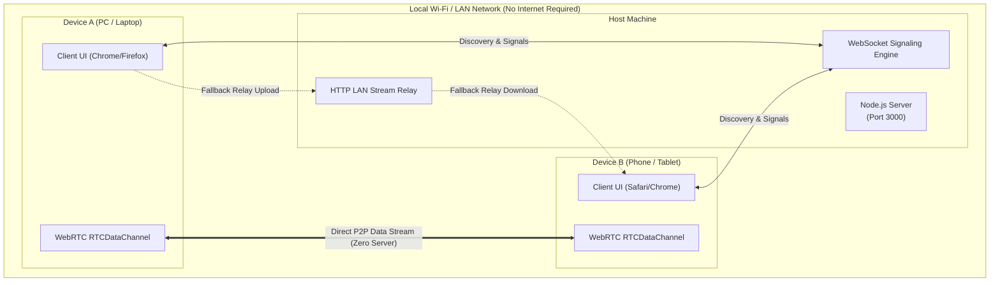

# 📡 LAN-Drop Ultra

> **Ultra-fast, zero-cloud P2P Local Network File and Text Sharer.**  
> Think *AirDrop* or *Snapdrop*, but completely self-hosted, private, cross-platform, with instant terminal QR pairing and synthesized audio feedback.

[](LICENSE)
[](https://nodejs.org/)
[](#architecture)
[](#privacy--security)

---

## ✨ Features

- ⚡ **True WebRTC Peer-to-Peer:** Files stream directly browser-to-browser at maximum local Wi-Fi / LAN speeds without going through external cloud servers or eating your internet data.
- 📲 **Instant QR Code Pairing:** Starts up and renders an ASCII QR code in your terminal and on the web UI. Point your phone/tablet camera, scan, and you're paired in 2 seconds.
- 🔄 **LAN Relay Fallback:** Seamless automatic fallback to local high-speed chunked HTTP streaming if WebRTC is blocked by strict router NAT or firewall rules.
- 💬 **Instant Clipboard & Text Sharing:** Send long links, passwords, phone numbers, or notes from your PC to phone (and vice-versa) with 1-click clipboard paste and copy.
- 🎯 **Device Discovery Radar:** Animated real-time radar showing nearby connected peers on your Wi-Fi network, auto-detecting device type (iOS, Android, Windows, Mac, Linux).
- 🛡️ **Chunked Transfer & Backpressure:** Handles massive 4K video files or gigabyte archives smoothly using 64KB chunking without exhausting browser memory.
- 🔔 **Synthesized AirDrop-style Audio Chimes:** Built-in spatial audio cues using the browser Web Audio API—zero heavy MP3 asset downloads.
- 🎨 **Modern Dark Glassmorphism UI:** Mobile-first, sleek, responsive design crafted with clean CSS and glowing ambient effects.

---

## 🏗️ Architecture



---

## 🚀 Quick Start

### Prerequisites
- [Node.js](https://nodejs.org/) (v18 or higher) installed on the host machine.
- Devices must be connected to the same Wi-Fi, Ethernet, or Mobile Hotspot.

### Installation & Run

1. **Clone the repository:**
   ```bash
   git clone https://github.com/baadaldev/lan-drop.git
   cd lan-drop
   ```

2. **Install dependencies:**
   ```bash
   npm install
   ```

3. **Start the server:**
   ```bash
   npm start
   ```

4. **Connect your devices:**
   - On your host computer, open `http://localhost:3000`.
   - On your phone or secondary laptop, scan the **QR Code printed in the terminal** or open the printed local IP (e.g., `http://192.168.0.105:3000`).
   - Start dropping files and sharing text!

---

## 📊 Comparison

| Feature | LAN-Drop Ultra | Apple AirDrop | Snapdrop / Sharedrop | WhatsApp / Telegram |
| :--- | :---: | :---: | :---: | :---: |
| **Cross-Platform** (Win, Mac, Android, iOS, Linux) | ✅ **Yes** | ❌ Apple Only | ✅ Yes | ✅ Yes |
| **Zero Internet / Local Only** | ✅ **Yes** | ⚠️ Proprietary | ❌ Requires Cloud STUN/Signaling | ❌ Heavy Cloud Data |
| **Terminal QR Code Pairing** | ✅ **Yes** | ❌ No | ❌ No | ❌ No |
| **Text & Clipboard Sharing** | ✅ **Yes** | ⚠️ Apple Ecosystem | ❌ No | ⚠️ Cluttered chat |
| **LAN Relay Fallback** | ✅ **Yes** | ❌ No | ❌ Fails on NAT | ❌ Cloud only |
| **Zero File Size Limits** | ✅ **Yes** | ⚠️ Device limited | ⚠️ Unstable on GBs | ❌ Limited (2GB) |

---

## 🔒 Privacy & Security

- **100% Local:** All data packets stay strictly inside your local home or office network.
- **Zero Cloud Storage:** Your files and text clips are never sent to external servers or logged in third-party databases.
- **Ephemeral Transfers:** Relay fallback files are automatically wiped after 15 minutes.

---

## 🛠️ Tech Stack

- **Backend:** Node.js, Express, `ws` (WebSockets), `multer`, `qrcode`, `qrcode-terminal`
- **Frontend:** Vanilla HTML5, Modern CSS (Glassmorphism), WebRTC (`RTCPeerConnection`, `RTCDataChannel`), Web Audio API, WebSockets

---

## 🤝 Contributing

Contributions, issues, and feature requests are welcome!  
Feel free to check out the [issues page](../../issues).

---

## 📜 License

Distributed under the **MIT License**. See `LICENSE` for more information.

Developed with ❤️ by **[Baadal](https://github.com/baadaldev)**
