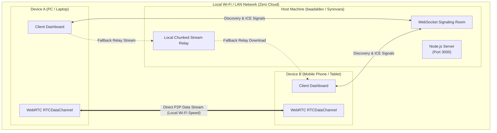

<div align="center">

# 📡 LAN-Drop Ultra By Rakib
### *Ultra-Fast, Zero-Cloud P2P Local Network File & Text Sharer*

<p align="center">
  <a href="https://github.com/Synovara" target="_blank">
    
  </a>
  &nbsp;
  <a href="https://github.com/baadaldev" target="_blank">
    
  </a>
  &nbsp;
  
</p>

<p align="center">
  
  &nbsp;
  
  &nbsp;
  
  &nbsp;
  
</p>

<p align="center">
  <strong>Think <em>Apple AirDrop</em> or <em>Snapdrop</em>, but fully self-hosted, cross-platform, equipped with instant terminal QR pairing, WebRTC data chunking, and synthesized spatial audio feedback.</strong>
</p>

---

</div>

## 🌌 An Open-Source Synovara Initiative

**LAN-Drop Ultra** is developed under **[Synovara](https://github.com/Synovara)**—an independent engineering lab and software collective focused on building resilient distributed systems, high-performance architectures, and intelligent software tools.

Bridging peer-to-peer networking rigor with an effortless mobile-friendly user experience, LAN-Drop Ultra eliminates external cloud dependencies for local device communications.

---

## ⚡ Key Highlights

* 🚀 **True WebRTC Peer-to-Peer:** Streams files directly between browsers on your local network at maximum Wi-Fi speeds without ever leaving your router.
* 📲 **Instant Terminal & UI QR Pairing:** Starts up and renders an ASCII QR code right in your terminal. Point your iPhone or Android camera, tap the link, and you are paired in seconds.
* 🔄 **Bulletproof LAN Relay Fallback:** When strict firewall/NAT settings hinder WebRTC handshakes, LAN-Drop seamlessly routes data via high-speed chunked local HTTP streams.
* 💬 **Instant Text & Clipboard Sharing:** Transfer long URLs, passwords, API tokens, and markdown notes from PC to phone (and vice-versa) with 1-click clipboard integration.
* 🎯 **Animated Device Discovery Radar:** Real-time presence detection maps connected peers on your Wi-Fi, auto-detecting device models (iOS, Android, Windows, Mac, Linux).
* 🛡️ **Chunked Transfer with Backpressure:** Effortlessly transfers gigabyte-sized files and 4K video clips using 64KB slicing and flow control to prevent browser memory spikes.
* 🔔 **AirDrop-Style Synthesized Spatial Chimes:** Audio feedback created on-the-fly using the browser's native Web Audio API—no heavy MP3 downloads required.
* 🎨 **Cyber-Dark Glassmorphic UI:** Modern responsive dashboard featuring smooth animations, live transfer speeds (`MB/s`), and remaining ETA indicators.

---

## 🏗️ System Architecture



---

## 🚀 Quick Start Guide

### 1. Clone & Install
```bash
git clone https://github.com/baadaldev/LAN-Drop-Ultra.git
cd LAN-Drop-Ultra
npm install
```

### 2. Launch Server
```bash
npm start
```

### 3. Connect Any Device
* **On your host PC:** Navigate to `http://localhost:3000`
* **On your phone/tablet:** Scan the **terminal QR code** or enter your local IP:
  ```text
  http://<YOUR_LOCAL_IP>:3000
  ```
* Open the web app on any device on the same Wi-Fi network and start dropping files!

---

## 📊 Feature Matrix

| Capability | LAN-Drop Ultra | Apple AirDrop | Snapdrop / Sharedrop | Cloud Apps (Telegram/Drive) |
| :--- | :---: | :---: | :---: | :---: |
| **Cross-Platform Compatibility** | ✅ **All Platforms** | ❌ Apple Only | ✅ Yes | ✅ Yes |
| **Zero Internet / Local-Only** | ✅ **100% Local** | ⚠️ Proprietary | ❌ Needs Cloud Signaling | ❌ Eats Internet Data |
| **Terminal ASCII QR Code** | ✅ **Built-in** | ❌ No | ❌ No | ❌ No |
| **Text & Clipboard Synchronizer** | ✅ **1-Click** | ⚠️ Apple Ecosystem | ❌ No | ⚠️ Chat Bloat |
| **Local Fallback Relay** | ✅ **Automatic** | ❌ No | ❌ Fails on Strict NAT | ❌ Cloud Only |
| **No File Size Caps** | ✅ **Unlimited** | ⚠️ Device limited | ⚠️ Drops on Large Files | ❌ Limited Tier |

---

## 🛠️ Technology Stack

* **Core Runtime:** Node.js, Express
* **Signaling & Real-time:** `ws` (WebSockets)
* **Local Streaming Fallback:** `multer` (ephemeral disk storage with 15-minute auto-cleanup)
* **P2P Transport:** WebRTC (`RTCPeerConnection`, `RTCDataChannel`)
* **QR Matrix Engines:** `qrcode` (web modal), `qrcode-terminal` (instant CLI)
* **Sound Design:** Web Audio API (real-time synthesized multi-tone frequencies)

---

## 🔒 Security & Privacy

* **Zero Logging:** No data is tracked, saved to external databases, or sent to telemetry endpoints.
* **Ephemeral Memory:** Any relayed file is strictly scoped to local RAM/temporary storage and automatically deleted after 15 minutes.
* **Confined LAN Scope:** Packets never leave your local wireless router perimeter.

---

## 🤝 Contributing

Contributions, feedback, and issue submissions are welcomed!  
Explore existing discussions or submit a pull request via the [Issues](../../issues) tab.

---

## 📜 License

Distributed under the **MIT License**. See [LICENSE](LICENSE) for details.

<div align="center">
  <sub>Architected with dedication by <strong><a href="https://github.com/baadaldev">Baadal</a></strong> for <strong><a href="https://github.com/Synovara">Synovara</a></strong>.</sub>
</div>
